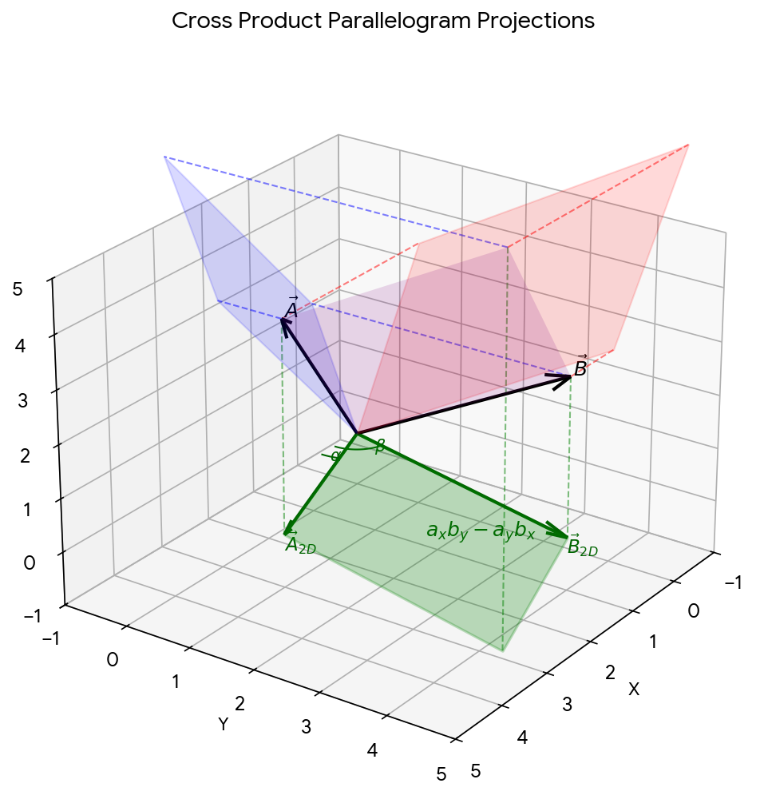

# Summary

## Cross Product

$$\vec{a} = a_x \hat{i} + a_y \hat{j} + a_z \hat{k}, \quad \vec{b} = b_x \hat{i} + b_y \hat{j} + b_z \hat{k}, \quad \vec{c} = \vec{a} \times \vec{b}$$

### Magnitude

$$
|\vec{c}| = |\vec{a} \times \vec{b}| = |\vec{a}| |\vec{b}| \sin\theta
$$

$$
= |\vec{a}| |\vec{b}| \sqrt{1 - \cos^2\theta}
$$

$$
= \sqrt{| \vec{a} |^2 | \vec{b} |^2 - | \vec{a} |^2 | \vec{b} |^2 \cos^2\theta}
$$

$$
= \sqrt{| \vec{a} |^2 | \vec{b} |^2 - (\vec{a} \cdot \vec{b})^2}
$$

$$
= \sqrt{(a_x^2 + a_y^2 + a_z^2)(b_x^2 + b_y^2 + b_z^2) - (a_x b_x + a_y b_y + a_z b_z)^2}
$$

$$
= \sqrt{(a_x b_y - a_y b_x)^2 + (a_y b_z - a_z b_y)^2 + (a_z b_x - a_x b_z)^2}
$$

$$
= \sqrt{c_x^2 + c_y^2 + c_z^2} 
$$

### Orthogonality

$$
\vec{a} \cdot (\vec{a} \times \vec{b}) = 0 \implies a_x c_x + a_y c_y + a_z c_z = 0
$$

$$
\implies \pm ( a_x(a_y b_z - a_z b_y) + a_y(a_z b_x - a_x b_z) + a_z(a_x b_y - a_y b_x) ) = 0
$$

$$
\therefore \quad c_x = \pm (a_y b_z - a_z b_y) \ , \quad c_y = \pm (a_z b_x - a_x b_z) \ , \quad c_z = \pm (a_x b_y - a_y b_x) 
$$

### 2D Projection on $(\hat{u}, \hat{v}) \in \{(\hat{i}, \hat{j}) , \ (\hat{j}, \hat{k}) , \ (\hat{k}, \hat{i})\}$

$$
\vec{a}_{\text{2D}} = a_u \hat{u} + a_v \hat{v} = (|\vec{a}_{\text{2D}}| \cos\alpha)\hat{u} + (|\vec{a}_{\text{2D}}| \sin\alpha)\hat{v}
$$

$$
\vec{b}_{\text{2D}} = b_u \hat{u} + b_v \hat{v} = (|\vec{b}_{\text{2D}}| \cos\beta)\hat{u} + (|\vec{b}_{\text{2D}}| \sin\beta)\hat{v} 
$$

#### Trigonometry and Components

$\hat{w}$: can be one of $\hat{i}, \hat{j}, \hat{k}$

subscript w: can be one of x, y, z

$$
\vec{a}_{\text{2D}} \times \vec{b}_{\text{2D}} = |\vec{a}_{\text{2D}}| |\vec{b}_{\text{2D}}| \sin(\beta - \alpha) \hat{w}
$$

$$
\vec {c} = \sum (c_w) \hat{w}
$$

the magnitude of the above expression is equal to the area of a parallelogram

$$
|\vec{a}_{\text{2D}}| |\vec{b}_{\text{2D}}| \sin(\beta - \alpha) = |\vec{a}_{\text{2D}}| |\vec{b}_{\text{2D}}| (\sin\beta \ \cos\alpha - \cos\beta \ \sin\alpha)
$$

$$
= (|\vec{a}_{\text{2D}}| \cos\alpha)(|\vec{b}_{\text{2D}}| \sin\beta) - (|\vec{a}_{\text{2D}}| \sin\alpha)(|\vec{b}_{\text{2D}}| \cos\beta)
$$

$$
= a_u b_v - a_v b_u = c_w \quad \implies \quad \sum (c_w) \hat{w} = (a_u b_v - a_v b_u) \hat{w}
$$

$$
\therefore \quad \vec{c} = (a_y b_z - a_z b_y)\hat{i} + (a_z b_x - a_x b_z)\hat{j} + (a_x b_y - a_y b_x)\hat{k}
$$

Each component of $\vec c$ relates to the area of the parallelogram formed by the surface vectors, with the sign (+/-) dictated by the Right-Hand Rule.

  

## Curl

$$
\vec{F} = P(x, y)\hat{i} + Q(x, y)\hat{j}
$$

$$
\nabla = \frac{\partial}{\partial x}\hat{i} + \frac{\partial}{\partial y}\hat{j}
$$

Using the 2D projection rule, the cross product $\nabla \times \vec{F}$

$$
\nabla \times \vec{F} = \left( \frac{\partial Q}{\partial x} - \frac{\partial P}{\partial y} \right) \hat{k}
$$

### Microscopic Torque and Derivation of Curl Component on xy-plane

each component adds up $\rightarrow$ if magnitude $\neq 0$, then rotation exists

#### torque definition 

$\tau = r F \sin\theta \hat{k} = (\vec{r} \times \vec{F})$

Counter-clockwise (CCW) rotation corresponds to $+\hat{k}$, and clockwise (CW) rotation corresponds to $-\hat{k}$.

##### Horizontal Edges (Contribution of $P$):
* Bottom side at $(a, b-\Delta y)$: contribution to rotation $\implies +P(a, b-\Delta y) \Delta x$
* Top edge at $(a, b+\Delta y)$: contribution to rotation $\implies -P(a, b+\Delta y) \Delta x$
* Combined Horizontal Sign (net contribution to rotation): $[P(a, b-\Delta y) - P(a, b+\Delta y)]\Delta x$

##### Vertical Edges (Contribution of $Q$):
* Right edge at $(a+\Delta x, b)$: contribution to rotation $\implies +Q(a+\Delta x, b) \Delta y$
* Left edge at $(a-\Delta x, b)$: contribution to rotation $\implies -Q(a-\Delta x, b) \Delta y$
* Combined Vertical Sign (net contribution to rotation): $[Q(a+\Delta x, b) - Q(a-\Delta x, b)] \Delta y $

$$
\lim_{\substack{\Delta x \to 0 \\ \Delta y \to 0}} \left( [P(a, b-\Delta y) - P(a, b+\Delta y)]\Delta x + [Q(a+\Delta x, b) - Q(a-\Delta x, b)]\Delta y \right) \hat{k} = \left( \frac{\partial Q}{\partial x} - \frac{\partial P}{\partial y} \right) dy \ dx \ \hat{k}
$$

the central differences converge exactly to the partial derivatives at the center point $(a, b)$, and the differential area element becomes $dx = 2\Delta x$, $dy = 2\Delta y$

## Lesson and Limitation

### For Cross Product Derivation: 

- it is important to derive the formula even if it is a definition $\rightarrow$ it builds a deeper intuition about space

### For Curl Equation Derivation (although partly unsolved):

- was only able to handle 2D Curl
- a whole phenomenon (rotation) is actually a sum of microscopic rules
- a big concept (net torque) can be used to connect with a point rotation (an expression handling a microscopic part)

